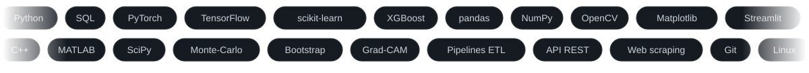

 

---

## À propos

Titulaire d'un Master 2 MAPI3 (Mathématiques appliquées pour l'ingénierie, l'industrie et l'innovation) de l'Université Toulouse III – Paul Sabatier, je m'intéresse à la Data Science, au Machine Learning et au Deep Learning.

Mes expériences en recherche appliquée m'ont permis de travailler sur des problématiques concrètes, de la préparation des données à l'expérimentation de modèles d'intelligence artificielle, en passant par l'analyse et la visualisation des résultats.

Je peux contribuer à des projets nécessitant :

- La préparation, le nettoyage et l'analyse de données.
- Le développement et l'évaluation de modèles de Machine Learning.
- L'utilisation de réseaux de neurones pour l'analyse de données et le traitement d'images.
- La visualisation et l'interprétation des résultats des modèles.
- L'exploration de méthodes d'intelligence artificielle explicable (XAI).

Je souhaite aujourd'hui mettre mes compétences en mathématiques appliquées et en intelligence artificielle au service de projets concrets, au sein d'une équipe technique ou de recherche.

Je recherche un premier poste en **Data Science, Machine Learning ou Intelligence Artificielle**, en CDI ou CDD en France.

## Expérience

### Data Scientist stagiaire — L2MGC, CY Cergy Paris Université
*Avril – juillet 2026*

Projet de prédiction des propriétés mécaniques des matériaux cimentaires à partir de données scientifiques et d'images de microstructure.

- Constitution et structuration d'un corpus de 388 articles scientifiques et d'environ 2 297 formulations.
- Préparation des données et traitement des valeurs manquantes.
- Expérimentation et comparaison de modèles de Machine Learning et de Deep Learning.
- Évaluation de modèles de prédiction, dont XGBoost, avec un R² de 0,76 dans le cadre de l'évaluation réalisée.
- Exploration de méthodes de traitement d'images et de visualisation pour analyser les données et les résultats.

### Stagiaire R&D — Visualisation et explicabilité des réseaux de neurones
*IRIT, Université Toulouse III – Paul Sabatier | Mai – août 2025*

Projet consacré à la visualisation du fonctionnement des réseaux de neurones, du perceptron aux réseaux convolutifs, puis à l'exploration de méthodes d'explicabilité appliquées à ResNet18.

- Développement d'outils Python pour visualiser les frontières de décision et l'évolution de l'apprentissage.
- Expérimentation avec NumPy, scikit-learn et PyTorch.
- Visualisation des filtres convolutifs et des cartes d'activation des CNN.
- Exploration de Grad-CAM pour examiner les régions d'une image contribuant aux prédictions.
- Étude de méthodes d'analyse de l'importance des filtres et création de visualisations pour examiner le comportement du modèle.

## Compétences techniques

## Portfolio et contact

Retrouvez mes projets et mes travaux sur mon portfolio et GitHub.

| | |
|:---|:---|
| **Portfolio** | [dialloalassane052001-ui.github.io/portfolio](https://dialloalassane052001-ui.github.io/portfolio/) |
| **GitHub** | [github.com/dialloalassane052001-ui](https://github.com/dialloalassane052001-ui) |
| **LinkedIn** | [linkedin.com/in/moussa-diallo-b203473a2](https://www.linkedin.com/in/moussa-diallo-b203473a2/) |
| **Email** | [diallomoussa052001@gmail.com](mailto:diallomoussa052001@gmail.com) |
| **Téléphone** | 06 65 78 47 63 |
